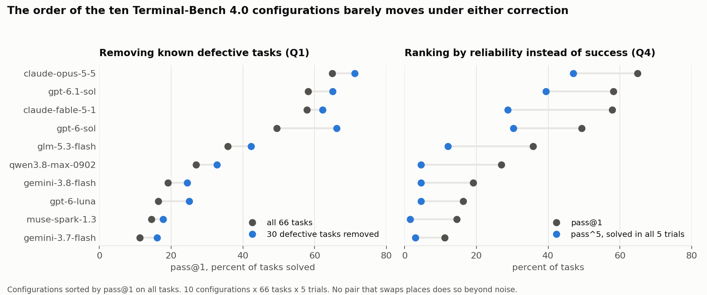
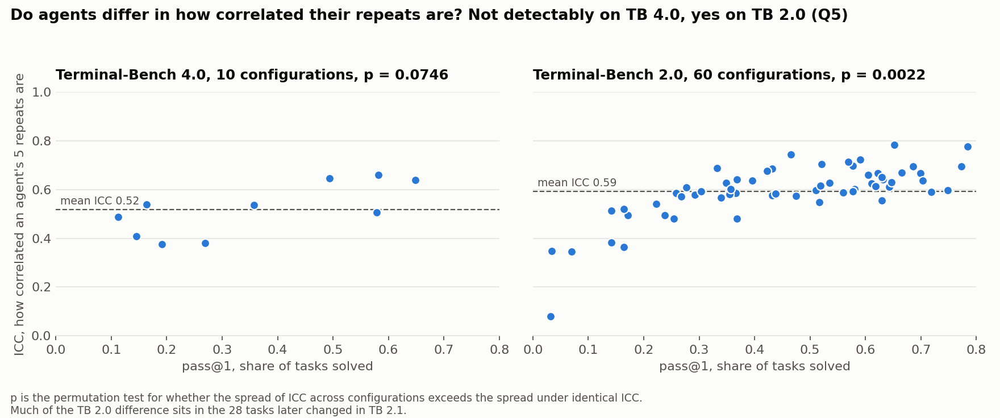
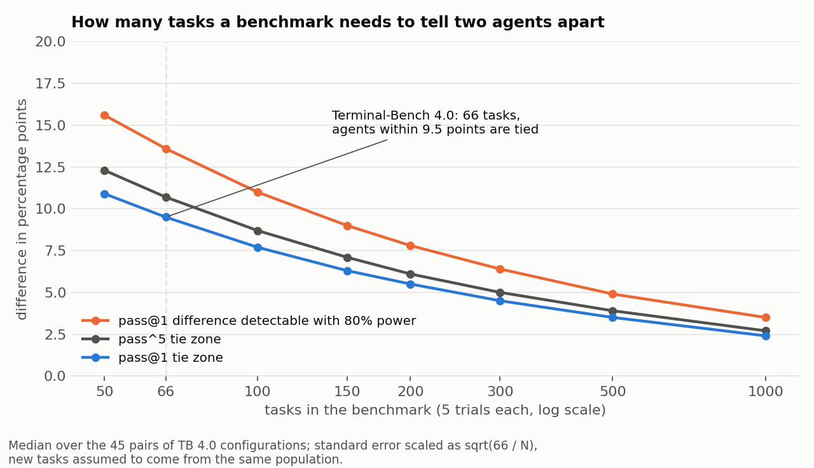

# Honest agent scores

[](https://doi.org/10.6084/m9.figshare.34515048)

**Do benchmark defects or repeated runs change which AI agent wins?** On 3,300 public Terminal-Bench 4.0 runs, mostly no: neither removing known defective tasks nor ranking by reliability on repeats (pass^k) changes the leader beyond noise. How correlated an agent's repeats are (ICC) does differ between configurations on Terminal-Bench 2.0, but much of that difference sits in the 28 tasks the benchmark later changed, and whether that is because they were broken or merely hard is open. A 66-task benchmark cannot resolve differences smaller than about 10 points.

This repository is a reproducible check of two common claims in **AI agent evaluation** on public per-trial results from **Terminal-Bench**: that **benchmark defects** hide the true leader, and that measuring **reliability** with **pass^k** reorders agents. It also ships a small tool to run the same checks on your own leaderboard, and a table of how many tasks a benchmark needs to tell two agents apart. The result is negative and stated with its limitations.

## Results

| # | Question | Data | Result |
|---|---|---|---|
| Q1 | Does removing Epoch's 30 defective tasks change the ranking more than removing 30 random tasks? | TB 4.0, 10 configurations x 66 tasks x 5 trials | **No change detected**: 3 rank inversions vs a random-removal median of 1 (95th percentile 3), p = 0.116; no flipped pair is significant. Low power against a shift of one or two places. |
| Q2 | Do the defects inflate the repeat correlation (ICC)? | TB 4.0 | Median ICC 0.522 -> 0.532 (null range of the change [-0.072, +0.067]). A drop larger than about 0.07 is ruled out. |
| Q3 | Who benefits from false positives? | TB 4.0 | All configurations do **worse** on false-positive tasks: those tasks are harder. Exploitation is not ruled out; it would need trajectories. |
| Q4 | Does ranking by pass^5 differ from ranking by pass@1? | TB 4.0 | **No**: two pairs reverse under pass^5 (four reversals counting pass^3 as well, three distinct pairs), none significantly; Qwen 3.8 Max, Gemini 3.8 Flash and GPT-6 Luna are tied at pass^5 = 3/66. pass^5 / pass@1 ranges from 0.10 to 0.72 across configurations. |
| Q5 | Do agents differ in how correlated their repeats are (ICC) beyond noise? | TB 4.0; TB 2.0 (60 configurations x 89 tasks; corrected 2026-10-13) | TB 4.0 p = 0.075. TB 2.0 **p = 0.0022: yes by the plan**, robust to trial choice, selection rule and dropping the weakest configurations. It weakens without the 28 tasks changed in TB 2.1 (p = 0.047; 0.25 if the weakest configurations are also dropped, one of four post-hoc combinations). Removing 28 unchanged tasks of matched difficulty does not weaken it (p <= 0.004 in all 200 draws), so difficulty alone does not explain it (the match is imperfect: pooled success 0.34 against 0.29). "Broken tasks create false reliability differences" is still an exploratory **hypothesis**, now with supporting evidence; the cause is not shown. |
| Power | How large a difference can a benchmark resolve? | TB 4.0 pairs | With 66 tasks, pass@1 differences within about **+-9.5 points** are ties; the tie zone narrows to 5 points at about 240 tasks, and detecting a 5-point difference with 80% power needs about 500 (table below). |





Exploratory results (chosen after seeing the data) are reported separately in [docs/RESULTS.md](docs/RESULTS.md), including one candidate pair whose order flips without the defective tasks (Fable 5.1 vs GPT-6 Sol, paired shift -12.4 points, 95% CI [-21.9, -3.8], no multiplicity correction).

- Full results with all caveats: [docs/RESULTS.md](docs/RESULTS.md)
- Analysis plan, fixed before each analysis was run: [docs/ANALYSIS_PLAN.md](docs/ANALYSIS_PLAN.md)
- Data sources and licenses: [DATA.md](DATA.md)

## How many tasks does a benchmark need?

Median across the 45 pairs of TB 4.0 configurations; standard error scaled as sqrt(66 / N), assuming new tasks come from the same population.

| Tasks | pass@1 differences that look like ties (+- points) | pass@1 difference detectable with 80% power | pass^5 tie zone (+- points) |
|---|---|---|---|
| 50 | 10.9 | 15.6 | 12.3 |
| 66 | 9.5 | 13.6 | 10.7 |
| 100 | 7.7 | 11.0 | 8.7 |
| 200 | 5.5 | 7.8 | 6.1 |
| 500 | 3.5 | 4.9 | 3.9 |
| 1000 | 2.4 | 3.5 | 2.7 |



Practical reading: on a leaderboard with about 66 tasks and 5 trials per task, two agents within 10 points of each other are not reliably ordered.

## Check your own leaderboard

If you have per-trial results with at least 5 trials per task (a CSV with columns `model, task, reward`), run the same tests on them:

```bash
python scripts/check_leaderboard.py --trials my_trials.csv --defects my_defects.json --out-dir report/
```

`--defects` is optional: a JSON file with `false_positive` and `false_negative` task lists (see `data/epoch_defects_tb40.json`). The tool writes `report/report.md` and `report/report.json`: ranking by pass@1 and pass^5, the tie zone for your number of tasks, whether known defects change the ranking, whether pass^5 reorders it, and whether ICC differs between models. It uses the same code, seeds and settings as this study. A "model" can be any unit you compare, such as model x harness x effort.

## Reproduce

Only the Python 3.9+ standard library is needed.

```bash
python reproduce.py --quick   # TB 4.0 analyses, about 5 minutes (downloads the TB 4.0 trials first)
python reproduce.py           # everything, including TB 2.0, about 3 hours
```

`reproduce.py` first downloads the Terminal-Bench 4.0 trials from Harbor Hub (`scripts/fetch_tb40_trials.py`) and checks them against the SHA-256 in `data/tb40_submissions.json`; then it writes every file in `results/`. All random draws use fixed seeds. The TB 4.0 trials are not included in this repository because their license is unclear; see [DATA.md](DATA.md).

| Script | Inputs | Output | Question |
|---|---|---|---|
| `scripts/fetch_tb40_trials.py` | `data/tb40_submissions.json`, Harbor Hub | `data/tb40_trials.csv` | data |
| `scripts/q1_q3_defects.py` | TB 4.0 trials, `data/epoch_defects_tb40.json` | `results/q1_q3_defects.json` | Q1-Q3 |
| `scripts/q4_repeats.py` | TB 4.0 trials | `results/q4_repeats.json` | Q4 |
| `scripts/q5_icc_heterogeneity.py` | TB 4.0 trials; prepared TB 2.0 trials | `results/q5_icc_tb40.json`, `results/q5_icc_tb20.json` | Q5 |
| `scripts/prep_tb20.py` | `data/tb20_trials.csv` | `data/tb20_q5_trials.csv` | Q5 data |
| `scripts/q5b_icc_residual.py` | TB 4.0 / TB 2.0 trials | `results/q5b_residual_*.json` | Q5b (exploratory) |
| `scripts/icc_slope_sensitivity.py` | TB 4.0, TB 2.0 trials, `data/tb21_changed_tasks.json` | `results/icc_slope_sensitivity.json` | Q5 robustness, ICC slope |
| `scripts/q5_task_removal_control.py` | TB 2.0 trials, `data/tb21_changed_tasks.json` | `results/q5_task_removal_control.json` | Q5 control: changed vs random tasks removed (exploratory) |
| `scripts/q5_task_removal_matched.py` | TB 2.0 trials, `data/tb21_changed_tasks.json` | `results/q5_task_removal_matched.json` | Q5 control: changed vs difficulty-matched tasks removed (exploratory) |
| `scripts/fetch_tb20_trials.py` | Hugging Face | `data/tb20_trials.csv` | data (included; re-download is optional) |
| `scripts/exploratory_checks.py` | TB 4.0 trials, defects | `results/exploratory_checks.json` | exploratory |
| `scripts/power_table.py` | TB 4.0 trials | `results/power_table.json` | power |
| `scripts/check_leaderboard.py` | any trials CSV | `report/` | your data |
| `scripts/make_figures.py` | `results/*.json` | `figures/*.png` | README figures (needs matplotlib, optional) |

## Limitations

- **Low power.** 10 configurations and 66 tasks. "No effect detected" is not "no effect": these tests cannot detect a change of one or two rank places.
- **Partial defect list.** Epoch's review stopped once the error rate passed its threshold, so the 36 unflagged tasks are unreviewed, not known to be clean.
- **Public submissions only.** 11 of 21 TB 4.0 submissions were private on Harbor Hub and are not included.
- **Repeat independence cannot be checked.** The `attempt` field is 1 for every trial.
- **Configurations, not models.** Each unit is a model with a specific harness and effort setting.
- **Errored trials count as failures** (124 of 3,300), which penalises pass^5 more than pass@1.
- **The TB 4.0 trials may disappear.** They stay on Harbor Hub and can become private; see [DATA.md](DATA.md).
- **The analysis plan was not registered on an external platform**; it was fixed in the author's version history before each analysis (details in [docs/ANALYSIS_PLAN.md](docs/ANALYSIS_PLAN.md)).

## Open questions

Things I could not settle with the public data. If you have the data or an argument, open an issue or a discussion.

- The Fable 5.1 vs GPT-6 Sol shift of 12.4 points without the defective tasks was found after seeing the data. Does it hold on later submissions of the same models, or after the 10 pending task fixes?
- Trajectories of the false-positive tasks would show whether models exploit the defects. Does anyone have them?
- The 28 tasks changed in Terminal-Bench 2.1 carry most of the ICC difference between configurations. Were they changed because they were broken, or because they were hard?

## Related

- [Agent Reliability Calculator](https://github.com/anaexplores/agent-reliability-calculator) ([demo](https://anaexplores.github.io/agent-reliability-calculator/)) estimates how many retries an agent pipeline needs when retries are correlated. This study supports its constant ICC preset of about 0.5-0.6: ICC rises with pass@1, but the size of that dependence is unstable (slope from 0.12 to 0.43 depending on the changed tasks and weak configurations), so the calculator should not model ICC as a function of pass@1.

## License

Code and documentation: MIT ([LICENSE](LICENSE)). `data/tb20_trials.csv`: Apache-2.0, from its source. See [DATA.md](DATA.md).
